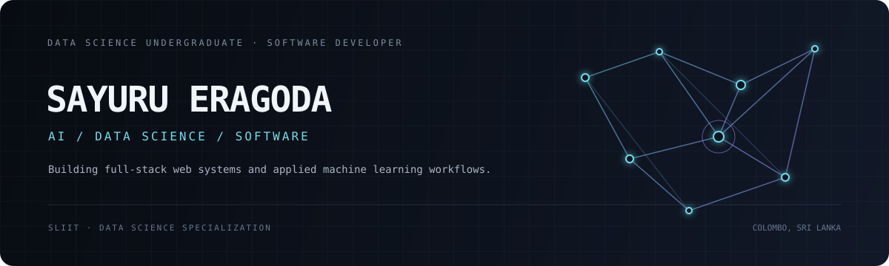

  

Software Developer passionate about Artificial Intelligence, Data Science, and emerging technologies. Currently pursuing a Bachelor’s degree in Information Technology specializing in Data Science, while continuously expanding my knowledge through learning, research, and hands-on projects. Interested in developing intelligent, data-driven solutions that create meaningful impact.

  

---

### 🔮Featured Projects

* [ParkNow](https://github.com/Academic-Projects-SLIIT/ParkNow-Vehicle-parking-management-system): a modern and intuitive parking management platform built to simplify the way drivers book parking spaces and help administrators manage operations efficiently.   `CSS` `JavaScript` `Java` `Spring Boot` `csv persistence`
* [AwardHub](https://github.com/SayuruPabasara/AwardHub): Web-based voting management system for Award Nominations   `React` `Vite` `Java` `Spring Boot` `SQL`
* [Online shoppers' purchase intention prediction](https://github.com/SayuruPabasara/Online-Shopping-Purchase-Intention-Prediction): Trained & evaluated multiple ML models on predicting Customer purchases   `Python` `Jupyter Notebook` `Scikit.learn` `pandas` `numpy` `matplotlib`

---

### ⚒️Technical Expertise

*   **Languages:** Java, Python, JavaScript, SQL
*   **Frontend:** React, CSS 
*   **Backend:** Java Spring Boot, REST API development
*   **Databases:** MySQL, SQL 
*   **AI & Data Science:** ML, DL & Gen AI Pipelines, Integrations
*   **Developer Tools:** Git, GitHub, Linux, Terminal

---

### 🎓Background

* BSc (Hons) in Information Technology - Data Science Specialization @ SLIIT *(Ongoing)*
* Freelance Software Developer *(2025 - Present)*

---

### Research & Learning Interests

- Artificial Intelligence and Machine Learning
- Data Science and predictive analytics
- Large Language Models and AI integration
- Intelligent automation
- Software architecture and backend engineering
- Linux and developer infrastructure
